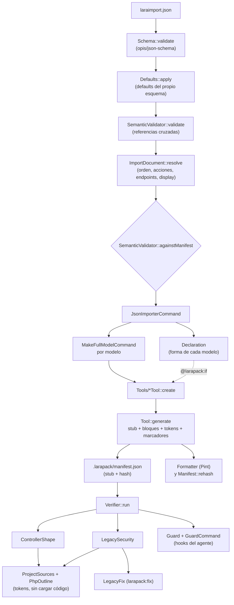

# Arquitectura de LaraPack

Este documento es para quien va a **cambiar el generador**, no para quien lo
usa. Cómo se usa está en el [README](README.md); cómo se prepara el entorno, se
prueba y se publica, en [CONTRIBUTING](CONTRIBUTING.md).

Todo lo que se cita aquí existe: `ArchitectureDocTest` comprueba que cada ruta,
cada enlace (con su ancla), cada test nombrado y cada «Clase::miembro» del
documento sigan en el código. Si mueves algo y el test falla, el documento es lo
que hay que arreglar.

## Índice

1. [El recorrido completo](#el-recorrido-completo)
2. [El contrato: esquema, valores por omisión y validación](#el-contrato-esquema-valores-por-omisión-y-validación)
3. [La importación](#la-importación)
4. [Las herramientas](#las-herramientas)
5. [Las plantillas](#las-plantillas)
6. [El formateo](#el-formateo)
7. [El manifiesto](#el-manifiesto)
8. [`verify`](#verify)
9. [La guardia y los hooks](#la-guardia-y-los-hooks)
10. [`fix`](#fix)
11. [`audit` y la línea base](#audit-y-la-línea-base)
12. [Cómo se registra un comando](#cómo-se-registra-un-comando)
13. [Principios de diseño](#principios-de-diseño)
14. [Mapa de directorios](#mapa-de-directorios)
15. [Dónde mirar para cada cambio](#dónde-mirar-para-cada-cambio)

---

## El recorrido completo

Lo que pasa entre que alguien escribe un `laraimport.json` y un agente recibe un
«no» en la guardia:



En una línea: **el esquema decide qué se puede declarar; la importación lo
convierte en estado; las herramientas copian plantillas con ese estado; el
manifiesto recuerda qué salió de dónde; `verify` compara lo que hay con lo que
debería haber; la guardia se lo dice al agente en el momento; `fix` paga la
deuda que se puede pagar sin pensar.**

---

## El contrato: esquema, valores por omisión y validación

### El esquema es la única fuente de verdad

[`schema/laraimport.schema.json`](schema/laraimport.schema.json) (JSON Schema
2020-12) describe todo lo que se puede declarar, con una `description` que dice
qué significa cada clave y por qué existe. Se publica con el paquete
(`extra.larapack.schema` en `composer.json`) y `larapack:schema` lo emite, para
que un editor o un agente validen antes de generar.

[`Schema::validate`](src/Support/Import/Schema.php) lo ejerce con
`opis/json-schema` y aplana los errores a `{path, message}` con el puntero JSON
del dato que falla.

### Los valores por omisión se leen del esquema

[`Defaults::apply`](src/Support/Import/Defaults.php) recorre el esquema
(siguiendo los `$ref` locales) y rellena cada clave ausente con su `default`.
No hay un solo valor por omisión escrito en PHP: si lo hubiera, acabaría
diciendo otra cosa que el esquema. Por eso un laraimport puede declarar sólo lo
que decide y no catorce booleanos por columna.

### Lo que el esquema no puede expresar

[`SemanticValidator`](src/Support/Import/SemanticValidator.php) mira varias
partes del documento a la vez: modelos y columnas repetidos, claves ajenas que
apuntan a algo que existe y sin ciclos, relaciones que resuelven, reglas sobre
campos que existen, `secret`, `metas`, `display`, `authenticatable`,
`table_prefix`, acciones referenciales y endpoints. Devuelve hallazgos con
nivel `error` o `warning`; sólo los errores bloquean.

Dos validaciones más viven aparte porque necesitan algo que el documento no
trae:

- `SemanticValidator::againstManifest` — lo que ya está generado: un
  `controllers[]` no puede llamarse como un modelo que ya existe.
- `SemanticValidator::interface` — avisos que sólo importan si se genera la
  interfaz (`--vue`, `--react`).

### El documento resuelto

[`ImportDocument::fromArray`](src/Support/Import/ImportDocument.php) encadena
todo, en este orden: rutas exclusivas (`only` con `except`, con un mensaje
propio), esquema, valores por omisión, semántica y, si no hay errores,
`resolve()`:

- ordena los modelos por sus dependencias, para que las migraciones corran;
- calcula las acciones de cada modelo con `Actions::resolve` y normaliza sus
  endpoints con `Endpoints::normaliseAll`;
- impone lo que no es negociable: un `secret` y la contraseña de un modelo
  `authenticatable` nunca salen en la exportación ni en la tabla; `payload`
  nunca se escribe desde la petición;
- decide la columna que nombra a un registro (`display`);
- resuelve el namespace de cada relación.

Las herramientas leen **sólo** este documento resuelto, nunca el JSON crudo: así
ninguna tiene que defenderse de una clave ausente, y una decisión se toma en un
único sitio.

[`Actions`](src/Support/Import/Actions.php) y
[`Endpoints`](src/Support/Import/Endpoints.php) son ese único sitio para dos
preguntas: qué acciones CRUD quedan después de `routes` e `immutable`
(`Actions::ALL`, `Actions::MODIFY`, `Actions::REQUIRES`), y cómo se llama cada
pieza que sale de un endpoint —método, request, ruta, habilidad, operación—.
El generador y `verify` preguntan ahí; si cada uno calculara su nombre, tarde o
temprano discreparían.

---

## La importación

[`JsonImporterCommand`](src/Commands/JsonImporterCommand.php)
(`larapack:import`) es el orquestador:

1. Valida con `ImportDocument::fromFile` y `SemanticValidator::againstManifest`
   **antes de tocar el disco**. Un laraimport inválido no deja medio proyecto
   escrito.
2. Publica el documento resuelto como estado de la ejecución:
   `Tool::setJsonContent`, `TablePrefix::fromDocument` y, por modelo y por
   controlador, `Declaration::fromModel` / `Declaration::fromController`.
3. Por cada modelo, ya ordenado, ejecuta
   [`MakeFullModelCommand`](src/Commands/MakeFullModelCommand.php) anidado. La
   lista de herramientas es `MakeFullModelCommand::$commands`, y cada nombre se
   resuelve por convención a `Tools\<Nombre>\<Nombre>Tool`. `--vue`, `--react` y
   `metas` añaden la suya.
4. Los pivotes van a `PivotMigrationTool`; los `controllers[]`, a
   `ControllerTool`, `RouteTool`, `EndpointTool` y, con interfaz, sólo al
   contrato JS.
5. Anota la forma declarada con `Manifest::declare`.
6. En un `finally`, limpia el estado: `Tool::setFromJsonImporter(false)`,
   `Declaration::reset()`, `TablePrefix::reset()`.

`larapack:full-model` suelto hace lo mismo para un modelo, con la forma que dan
sus opciones (`--only`, `--except`, `--immutable`) y los endpoints que ya
guardaba el manifiesto. Las dos vías usan las mismas primitivas a propósito:
generar un modelo suelto y generarlo desde el archivo no pueden dar dos
resultados distintos.

### El estado de una ejecución

Las herramientas reciben sólo el nombre del modelo. Lo demás lo leen de tres
sitios estáticos, que viven lo que dura un comando:

| Clase | Qué guarda |
|---|---|
| [`Declaration`](src/Support/Declaration.php) | La forma de cada modelo: acciones, `immutable`, `secret`, `metas`, `display`, `authenticatable`, endpoints. `Declaration::holds` responde a las condiciones de las plantillas. Un modelo sin declarar tiene la forma de siempre. |
| [`Generation`](src/Support/Generation.php) | `--force`, `--dry-run` y el registro de lo que se creó, regeneró, omitió o conservó. Es lo que pinta el informe y lo que se formatea después. |
| [`ProjectRoot`](src/Support/ProjectRoot.php) | Sobre qué proyecto se escribe. `--root` la fija; sin ella se descubre subiendo hasta un `vendor/autoload.php`. |

Por ser estáticos, los tests los reinician en cada `tearDown`
([`tests/TestCase.php`](tests/TestCase.php)). Si añades estado de ejecución,
añade también su `reset()` ahí y en el `finally` del importador.

Los helpers globales de [`src/Helpers/app.php`](src/Helpers/app.php) —
`root_path()`, `app_dir_name()`, `get_namespace()`, `stubs_path()` — se apoyan en
`ProjectRoot`. `app_dir_name()` decide si el destino es un paquete (`src/`, tipo
`library` en `composer.json`) o una aplicación (`app/`), y de esa decisión
cuelgan el namespace de factorías y tests, la clave de configuración y el
prefijo de las vistas de exportación (`Tool::init`).

---

## Las herramientas

Una herramienta por pieza, en `src/Tools/<Área>/<Área>Tool.php`, todas sobre
[`Tool`](src/Tools/Tool.php). Cada una expone `create(string $ModelName)` y
`remove(string $ModelName)`, decide el destino y llama a `Tool::generate`. Es
el camino **principal**, no el único (los demás, en
[la tabla de abajo](#lo-que-no-pasa-por-toolgenerate)), y es el único que da
todas las garantías de una vez:

1. Si existe y no hay `--force`: `skipped`.
2. Si existe y el manifiesto dice que se editó a mano (`Manifest::wasCustomised`):
   `preserved`. **Nada de lo editado se sobrescribe, ni con `--force`.**
3. Con `--dry-run`, se anota lo que haría y se sale.
4. Copia la plantilla y, en este orden:
   - `Tool::applyBlocks`: resuelve los bloques `@larapack:if` con
     `Declaration::holds`. Antes que nada, para que ningún marcador llegue al
     proyecto.
   - `Tool::replaceTokens` con `Tool::replacementMap`: los nombres del modelo y
     del namespace, en una sola pasada de `strtr()`.
   - `Tool::applyEndpoints`: los marcadores `//ENDPOINT_…//`, rellenos con
     `Tool::endpointCode` de cada herramienta. Después de los tokens, porque lo
     que inserta lleva nombres que no deben volver a sustituirse.
   - `Tool::processFileWithJson`, sólo desde el importador: cada herramienta
     sustituye sus marcadores (`//FILLABLE//`, `//EDIT//`, `//RULES//`…) con lo
     que dice el laraimport.
5. Anota el archivo en el manifiesto (`Manifest::record`) y en `Generation`.

Una herramienta puede especializar un paso sin salirse del camino:
`EndpointTool::applyBlocks` añade las condiciones de `Endpoints::FLAGS` a las
del modelo, y `ControllerTool::applyEndpoints` saca de `auth:sanctum` los
endpoints públicos. Siguen pasando por `generate()`, con todo lo demás.

### Lo que no pasa por `Tool::generate`

Hay archivos que se copian por su cuenta. Algunos a propósito (son de quien
mantiene el proyecto desde el primer momento), otros por historia. Ninguno se
sobrescribe nunca, tampoco con `--force`: si el destino existe, no se toca. Pero
**ninguno recibe gratis lo que hace `generate()`**: una plantilla nueva que
siga uno de estos caminos no tendrá bloques, manifiesto ni la comprobación de
`preserved` salvo que la herramienta los llame.

| Camino | Qué escribe | Bloques `@larapack:if` | Manifiesto | En el informe |
|---|---|---|---|---|
| `PackageTool::scaffold` | El andamiaje de `larapack:new` (`PackageTool::FILES`, la licencia y `phpunit.xml.dist`). | No. Tokens con `Tool::replaceTokens`, sin `Generation::written`. | No, a propósito: el README o un workflow que cambian no son una desviación. | Sí (`skipped` si existe). |
| `TestTool::copyOnce` | `TestCase.php`, el `User.php` de un paquete y `phpunit.xml`. | No. | No. | Sí; si existe, ni siquiera `skipped`. |
| `TestTool::createFeatureTest` | El test de endpoints de cada modelo (`tests/Feature/Models/<Modelo>EndpointsTest.php`). | Sí, llamando a `Tool::applyBlocks`. | No. | Sólo con `--dry-run`; se formatea por `Tool::replaceData`. |
| `ModelTraitsTool::create` | Los cinco traits de huecos. | Operations, Relations y Storage llaman a `Tool::applyBlocks`; Assignment y Mutators, no. | No: son huecos. | Sólo con `--dry-run`; se formatean por `Tool::replaceData`. |
| `PivotMigrationTool::create` | La migración de cada pivote. | No, y tampoco `Tool::replaceTokens`: sólo sustituye `migration_name`. | No. | Sí; si existe, ni siquiera `skipped`. |
| `MigrationTool::alter` | La migración `alter` cuando cambia una tabla que ya existe. | No. | Sí. | Sí. Si la migración de creación está editada, `preserved` y no escribe. |
| `MigrationTool::remove`, `PivotMigrationTool::remove` | La migración `drop` de `larapack:remove-full-model`. | No. | No. | No. |

Fuera de las herramientas escriben además `Skill::install`, `CiCommand`,
`AgentHooks` y `Translations`, cada uno con sus reglas; ninguno copia una
plantilla de `src/Stubs/` con tokens de modelo.

Se formatea lo que el informe anota como creado y lo que pasa por
`Tool::replaceData`, que anota el archivo con `Generation::written`. Las dos
copias que no lo llaman (`PackageTool::scaffold` y `PivotMigrationTool::create`)
pasan por Pint sólo porque se anotan con `Generation::record`: si dejaran de
hacerlo, quedarían sin formatear.

Las piezas que comparten más de una herramienta están arriba, no copiadas:
`Tool::phpString` (todo valor libre del laraimport sale escapado; un `default`
con comilla ya no rompe una migración), `Tool::defaultLiteral` (el `default` de
columna, igual en modelo y pivote; su forma es contrato, porque `alter()` compara
las definiciones como texto), `Tool::referentialActions`,
`Tool::migrationFile` (reutiliza la migración de creación que ya exista) y
`Tool::MODEL_NAME` (el nombre de modelo es un identificador: un `..` borraba
directorios enteros).

Casos que conviene conocer antes de tocarlos:

- [`UiModuleTool`](src/Tools/ModelView/UiModuleTool.php) decide **qué** lleva
  el módulo de interfaz; [`ModelViewTool`](src/Tools/ModelView/ModelViewTool.php)
  (Vue) y [`ReactViewTool`](src/Tools/ReactView/ReactViewTool.php) sólo
  **cómo** se escribe. `models/<entidad>/index.js` sale de la misma plantilla
  en los dos: es el contrato con el backend. `UiModuleTool::FORM_COMPONENTS`
  repite la lista `formComponent` del esquema.
- [`MigrationTool`](src/Tools/Migration/MigrationTool.php) no reescribe la
  migración de creación de una tabla que ya existe: compara las columnas del
  laraimport con lo que dejaron las migraciones anteriores y escribe una
  `alter`. Las marcas de tiempo salen de
  [`MigrationTimestamp`](src/Support/MigrationTimestamp.php), que garantiza que
  sean crecientes dentro de una ejecución.
- [`PackageTool`](src/Tools/Package/PackageTool.php) es el andamiaje de un
  paquete nuevo (`larapack:new`): `PackageTool::FILES` es la lista de archivos y
  `PackageTool::composerJson` saca las versiones de `ecosystem.json`.
- [`Translations`](src/Support/Translations.php) suma a `lang/` y a los JSON del
  front las claves que usan los archivos generados, sin tocar lo traducido a
  mano.
- [`TablePrefix`](src/Support/TablePrefix.php) es el `table_prefix` del
  laraimport: lo leen las migraciones, el modelo y las claves ajenas.

---

## Las plantillas

`src/Stubs/<Área>/*.txt`. Son texto, no PHP: no se cargan, se copian. Tres
mecanismos, en el orden en que se aplican:

**Bloques condicionales.** [`StubBlocks`](src/Support/StubBlocks.php):

```
// @larapack:if update
public function update(UpdateRequest $request) { ... }
// @larapack:endif
```

La sintaxis del comentario da igual (`//`, `<!-- -->`, `{/* */}`): se mira la
línea entera y **la línea del marcador desaparece siempre**. Por eso un modelo
con todas las acciones sale byte a byte igual que antes de que existieran los
marcadores. `a|b` es cualquiera, `a&b` todas, `!a` la negación; mezclar `&` y
`|` es un error a propósito. Las condiciones válidas son `Actions::ALL` y
`Declaration::FLAGS`, más `Endpoints::FLAGS` en `src/Stubs/Endpoint/`. Una
condición desconocida lanza: un bloque que se cae en silencio sólo se
descubriría en producción.

**Tokens.** `ModelName`, `snake_case_model_name`, `pluralkebabcasemodelname`,
`Namespace\`, `table_name`… (`Tool::replacementMap`). `strtr()` prueba las
claves de mayor a menor longitud y no vuelve a recorrer lo sustituido, así que
el orden no importa y un valor insertado no puede casar con otro token.

**Marcadores de contenido.** Comentarios como `//EDIT//` o `//RULES//` que una
herramienta sustituye con datos del laraimport, y `//ENDPOINT_…//`, que
desaparecen con su fin de línea cuando no hay endpoints.

Las plantillas de un paquete nuevo están en `src/Stubs/Package/`; las
traducciones que LaraPack ya conoce, en
[`src/Stubs/Locales/es.json`](src/Stubs/Locales/es.json).

---

## El formateo

Las plantillas no siguen ningún estilo. Al final de cada comando,
`ReportsGeneration::reportGeneration` pasa lo creado y regenerado por el Pint
**del proyecto destino** ([`Formatter::format`](src/Support/Formatter.php)),
con su `pint.json`. Así un paquete recién generado pasa `pint --test` en su CI
sin depender de que las plantillas estén al día con las reglas de Pint.

Sólo se formatea lo escrito en esa ejecución, nunca lo editado a mano, y lo que
el manifiesto conoce se vuelve a anotar con el hash ya formateado
(`Manifest::rehash`); si no, todo lo generado parecería editado. Sin Pint en el
proyecto, se avisa y se sigue. `Formatter::pint` acepta `LARAPACK_PINT` para
quien genera sin `vendor/`, como la propia suite.

---

## El manifiesto

[`Manifest`](src/Support/Manifest.php) escribe `.larapack/manifest.json` en el
proyecto destino:

```
{
  "version": 1,
  "package": { "namespace": "...", "files": { "<ruta>": { "stub": "...", "hash": "sha256" } } },
  "models": {
    "<Modelo>": {
      "namespace": "...",
      "files": { "<ruta>": { "stub": "Model/ModelTemplate.txt", "hash": "..." } },
      "declaration": { "actions": [...], "immutable": true, "secret": [...], "endpoints": [...] }
    }
  }
}
```

- **El hash es del contenido al generarlo**, con los finales de línea
  normalizados. Si cambia, el archivo se editó, que es legítimo: se conserva y
  `verify` lo informa como `customised`. Un archivo que el manifiesto no conoce
  cuenta como editado: el generador no toca lo que no escribió.
- **`declaration` sólo anota lo que se aparta de la forma de siempre**
  (`Declaration::toManifest`). Un proyecto que no usa claves nuevas tiene el
  manifiesto idéntico al de antes, y uno viejo se sigue leyendo: la ausencia
  significa «todas las acciones». `verify` no recibe el laraimport; sin esto no
  distinguiría un formulario que falta de uno que no se declaró.
- Se escribe en cada `record()`: si una herramienta aborta a mitad, el
  manifiesto refleja lo que de verdad quedó en disco.
- Lo que no es de ningún modelo (proveedores, configuración, andamiaje del
  módulo npm) va en `package`, fuera de la comparación entre entidades.

---

## `verify`

[`VerifyCommand`](src/Commands/VerifyCommand.php) llama a
[`Verifier::run`](src/Support/Verifier.php), que junta tres familias. Cada
hallazgo es `{level, check, model, file, message}`, con nivel `error`,
`warning` o `info`; `--strict` convierte los avisos en fallos y `--check`
(repetible) filtra por `Verifier::CHECKS`.

**Contra el manifiesto** (`Verifier::MANIFEST_CHECKS`): `missing-file`,
`customised`, `inconsistent-entity`, `route-prefix`, `route-not-declared`,
`endpoint-missing`, `immutable-write`, `secret-exposed`,
`endpoint-tests-outdated`. Se lee el manifiesto
una sola vez (`Manifest::snapshot`): releerlo en cada consulta hacía que un
proyecto grande tardara minutos. `inconsistent-entity` compara sólo contra el
consenso **unánime** de las entidades con la misma forma declarada; otra regla
daría ruido, y el ruido acaba desactivado.

**La forma de todos los controladores** —[`ControllerShape`](src/Support/ControllerShape.php),
`ControllerShape::CHECKS`—: `controller-shape`, `request-handle`,
`controller-concern`, `hand-rolled`, `route-closure`. No depende del
manifiesto: la deriva está justo en los controladores que el generador no
escribió. La excepción aprobada por el dueño del proyecto se declara con
[`#[HandRolled('razón')]`](src/Attributes/HandRolled.php) y se aprueba en
`.larapack/hand-rolled.lock` ([`HandRolledLock`](src/Support/HandRolledLock.php)),
con la razón y la huella del código (`HandRolledLock::methodFingerprint`,
`HandRolledLock::classFingerprint`): si cambia cualquiera de las dos, deja de
estar aprobada. Sin candado se lista como aviso en cada ejecución.

**Deuda de seguridad de lo generado antes** —[`LegacySecurity`](src/Support/LegacySecurity.php),
`LegacySecurity::CHECKS`—: `index-managed` y `resource-appends`. Avisos, no
errores: el código viejo funciona y arreglarlo es trabajo del proyecto.

Las dos últimas familias comparten dos piezas:

- [`ProjectSources`](src/Support/ProjectSources.php) dice **qué** se recorre:
  la raíz, los repositorios `path` de su `composer.json` y `packages/*`; de cada
  uno, sus directorios PSR-4; dentro, todo menos `vendor`, `node_modules` y lo
  oculto. Es una sola definición a propósito: con dos copias, un paquete que
  una ve y la otra no sería un agujero que nadie nota. Su docblock explica
  también lo que queda fuera (Livewire, Filament, controladores fuera de
  `Http/Controllers`).
- [`PhpOutline`](src/Support/PhpOutline.php) dice **cómo** se lee: el
  esqueleto de un archivo —clases, métodos, atributos, parámetros con su tipo
  resuelto, cuerpos como lista de tokens— con `token_get_all` y nada más. El
  código del proyecto nunca se carga ni se ejecuta, y un archivo a medio
  escribir no produce avisos (bajo Artisan, un aviso es una excepción).

---

## La guardia y los hooks

El skill es texto y un agente lo olvida a mitad de una sesión larga. La guardia
es la misma regla, ejecutada.

- [`AgentHooks`](src/Support/AgentHooks.php) instala, sin pisar nada del
  proyecto, los hooks en `.claude/settings.json`
  (`AgentHooks::installSettings`) y el bloque de
  [`skill/agents-block.md`](skill/agents-block.md) entre marcadores en
  `AGENTS.md` (`AgentHooks::installAgentsBlock`). `larapack:skill` escribe el
  bloque (salvo con `--no-agents`) y, con `--hooks`, los hooks; `larapack:new`
  deja las dos cosas puestas. El skill completo,
  [`skill/SKILL.md`](skill/SKILL.md), lo copia [`Skill`](src/Support/Skill.php).
- [`GuardCommand`](src/Commands/GuardCommand.php) (`larapack:guard`) recibe por
  la entrada estándar el JSON del hook. Tras cada edición (PostToolUse) mira si
  el archivo es arquitectura (`Guard::WATCHED`, menos los huecos de
  `Guard::HOLLOW_STUBS` y lo de terceros), corre el Verifier del proyecto al que
  pertenece el archivo y, si hay errores **en ese archivo**, sale con
  `GuardCommand::BLOCK` (2): Claude Code se lo devuelve al modelo mientras aún
  tiene el archivo delante. Con `--stop`, al final del turno, verifica el
  proyecto entero pero sólo retiene por lo que tocó la sesión
  (`Guard::remember`, `Guard::sessionFiles`).
- [`Guard`](src/Support/Guard.php) **no reimplementa ningún check**: filtra los
  hallazgos del Verifier por archivo (`Guard::findings`, `Guard::errorsFor`).
  Un check nuevo de `verify` llega a la guardia sin tocarla.

Todo lo que no es motivo para bloquear —una entrada vacía o rota, un archivo
que no es arquitectura, `vendor/`— sale con 0 y en silencio. Un hook que estorba
en cada edición acaba desactivado.

---

## `fix`

[`FixCommand`](src/Commands/FixCommand.php) (`larapack:fix`) arregla lo que
`LegacySecurity` marca, igual en cada archivo y a partir de la plantilla
actual. El trabajo lo hace [`LegacyFix`](src/Support/LegacyFix.php):

1. `LegacyFix::plan` parte de `LegacySecurity::inspect` (los mismos casos que
   `run()`, con clase y método en vez de mensaje).
2. Cada arreglo se localiza con `PhpToken`: la clase, el método y la sentencia
   exactos, y se reemplaza ese tramo del texto. Lo que no tiene una forma
   reconocida con certeza no se toca: vuelve como `skipped` con su razón, y el
   comando sale con código distinto de cero.
3. Nada se da por arreglado hasta que el resultado parsea y `LegacySecurity`,
   leyéndolo como *overlay* en memoria, ya no lo marca. Por eso correrlo dos
   veces no cambia nada la segunda.
4. `LegacyFix::withDiffs` da el diff ([`UnifiedDiff`](src/Support/UnifiedDiff.php))
   para `--dry-run`; `LegacyFix::apply` escribe, formatea y rehace el hash de
   lo que el manifiesto conocía sin editar.

Además **informa, sin arreglar**, de dos cosas que necesitan a una persona:
[`ManagedFilterAudit`](src/Support/ManagedFilterAudit.php) (un `canView()` sin
camino para el administrador) y [`AppendableProposals`](src/Support/AppendableProposals.php)
(qué accessors pide el front con `appends`). Son lecturas, no pruebas: no
cambian el código de salida y nunca se escriben solas.

---

## `audit` y la línea base

[`ecosystem.json`](ecosystem.json) es la fuente de verdad de versiones del
ecosistema: PHP, `illuminate/*`, Testbench, herramientas de desarrollo, Node,
la cadena JS, las dependencias internas de Composer (`internal`) y de npm
(`internalNpm`), lo que necesita el código generado (`generated`), los campos
obligatorios y los workflows.

- [`Ecosystem`](src/Support/Ecosystem.php) lo lee (`Ecosystem::rules`) y
  [`AuditCommand`](src/Commands/AuditCommand.php) (`larapack:audit`) audita un
  paquete Composer o npm contra él. Informa; no arregla.
- `PackageTool::composerJson` lo usa para el `composer.json` de un paquete
  nuevo, así que uno recién creado pasa el audit sin hallazgos.
- `GeneratedModuleDependenciesTest` comprueba que el `package.json` que generan
  las plantillas pida lo mismo que `internalNpm`. Una versión no se escribe en
  una plantilla: se escribe aquí.

---

## Cómo se registra un comando

No hay una lista de comandos. Hay una convención: **todo
`src/Commands/*Command.php` es un comando**, y lo descubren por glob tanto
[`builder`](builder) (el binario, fuera de Laravel) como
[`GeneratorServiceProvider`](src/Providers/GeneratorServiceProvider.php) (bajo
Artisan).

Los comandos son de Symfony Console, no de Illuminate: Artisan acepta cualquier
subclase de `Symfony\Component\Console\Command\Command`, y así la misma clase
sirve a `php artisan` y a `vendor/bin/builder`. El binario añade además, como
alias, el nombre histórico de cada uno (`larapack:x` → `make:x`;
`larapack:import` → `json:importer`); en Artisan no, porque `make:model` y
compañía son de Laravel. Para Symfony Console 7.4 y 8 a la vez, el binario usa
`addCommand()` si existe y `add()` si no.

Las piezas comunes van en traits de `src/Commands/Concerns/`:

| Trait | Qué da |
|---|---|
| [`TargetsProject`](src/Commands/Concerns/TargetsProject.php) | `--root`, que fija `ProjectRoot`. |
| [`ReportsGeneration`](src/Commands/Concerns/ReportsGeneration.php) | Lo de un generador: `--root`, `--force`, `--dry-run`, `--format`, el informe y el formateo con Pint. |
| [`WritesJson`](src/Commands/Concerns/WritesJson.php) | `--format=json` como un único documento, también cuando algo lanza: `{"ok": false, "error": "..."}`. |

`CommandRegistrationTest`, `ArtisanRegistrationTest` y `JsonOutputTest`
cubren que cada clase se registre, viva en `larapack:`, no pise un `make:*` de
Laravel y responda en un solo documento JSON.

---

## Principios de diseño

**Sólo comprobaciones deterministas.** `verify` no opina sobre «cuánta lógica es
demasiada»: comprueba que un archivo exista, que una acción sea
`return $request->handle();` o no lo sea, que una columna `secret` no salga. Una
comprobación con falsos positivos se desactiva, y una desactivada no protege
nada. Lo que no se puede decidir con certeza se **informa** como propuesta
(`AppendableProposals`, `ManagedFilterAudit`), sin tocar el código de salida.

**Huecos y generado.** Lo generado tiene una sola forma y se regenera; la lógica
de negocio va en los huecos que el generador deja para eso (traits de
`Operations`, `Relations`, `Storage`, `Mutators`; el `canView()` del ManagedFilter;
políticas, `rules()`, Resources, listeners, observers, factorías y tests). El
manifiesto es lo que permite que las dos cosas convivan: lo editado nunca se
pisa. La guardia no vigila los huecos (`Guard::HOLLOW_STUBS`): editarlos es el
trabajo normal.

**Una sola fuente de verdad por decisión.** El esquema para el contrato y sus
valores por omisión; `Actions` y `Endpoints` para los nombres; `ProjectSources`
para qué se recorre; `ecosystem.json` para las versiones; `skill/SKILL.md` para
la guía del agente. Cuando dos sitios dicen lo mismo, un test los compara
(`GeneratedModuleDependenciesTest`, `ReadmeExamplesTest`, `SkillTest`,
`ArchitectureDocTest`).

**Tokens y no expresiones regulares** sobre código que puede haber escrito
cualquiera. Una regex no sabe dónde acaba un método con llaves dentro, no
distingue un comentario de código ni resuelve un `use` con alias; los tokens sí.
`PhpOutline` lo hace para leer y `LegacyFix` (con `PhpToken`) para reescribir.
Sobre archivos que el manifiesto dice que generó LaraPack y nadie tocó, el
Verifier sí busca cadenas conocidas de la plantilla: ahí la forma está
garantizada.

**No cargar ni ejecutar el proyecto.** `verify`, `guard` y `fix` leen archivos.
Tienen que funcionar en un proyecto sin dependencias instaladas y no pueden
tener efectos.

**Fallar cerrado.** Una condición de plantilla desconocida, un nombre de modelo
que no es un identificador o una `--root` que no existe son errores, no un
«seguimos como podamos».

**Compatibilidad entre versiones.** Un laraimport que no usa una clave nueva
genera **byte a byte** lo mismo que antes de que existiera: la línea del
marcador desaparece, los valores por omisión reproducen el comportamiento
anterior y el manifiesto sólo anota lo que se aparta. Lo fija
`GeneratedOutputSnapshotTest` con un hash por archivo generado. Los nombres
viejos de los comandos siguen como alias en el binario, y las dependencias
aceptan dos mayores a la vez cuando el ecosistema está a medio migrar
(`symfony/console ^7.4 || ^8.0`, PHPUnit `^12 || ^13`). Qué cuenta como cambio
que rompe está en [CONTRIBUTING](CONTRIBUTING.md#qué-cuenta-como-cambio-que-rompe).

---

## Mapa de directorios

| Ruta | Qué hay |
|---|---|
| [`builder`](builder) | El binario: descubre los comandos y añade los alias históricos. |
| [`schema/`](schema/) | El esquema del laraimport. |
| [`src/Commands/`](src/Commands/) | Un archivo por comando; `Concerns/` con lo común. |
| [`src/Support/Import/`](src/Support/Import/) | Esquema, valores por omisión, validación semántica, documento resuelto, acciones y endpoints. |
| [`src/Support/`](src/Support/) | El resto del núcleo: estado de ejecución, manifiesto, formateo, `verify`, guardia, `fix`, `audit`. |
| [`src/Tools/`](src/Tools/) | Una herramienta por pieza generada, sobre `Tool`. |
| [`src/Stubs/`](src/Stubs/) | Las plantillas, por área. |
| [`src/Attributes/`](src/Attributes/) | `#[HandRolled]`, lo único que el código del proyecto importa del generador. |
| [`src/Helpers/app.php`](src/Helpers/app.php) | Helpers globales de rutas y namespace. |
| [`src/Providers/`](src/Providers/) | El proveedor de Laravel: configuración y comandos. |
| [`skill/`](skill/) | La guía para agentes y el bloque de `AGENTS.md`. |
| [`ecosystem.json`](ecosystem.json) | Las versiones del ecosistema. |
| [`docs/specs/`](docs/specs/) | Los specs de diseño de los cambios grandes, con lo que se decidió al implementarlos. |
| [`tests/Unit/`](tests/Unit/) | Piezas aisladas: contrato, bloques, tokens, `PhpOutline`, documentos. |
| [`tests/Feature/`](tests/Feature/) | Comandos sobre un proyecto falso en un temporal (`tests/Support/FakeProject.php`). |
| [`tests/EndToEnd/`](tests/EndToEnd/) | Lo generado se instala y se ejecuta: migra, llama a las rutas, compila el front. |
| [`tests/Fixtures/`](tests/Fixtures/) | Laraimports de prueba y las fotos de `GeneratedOutputSnapshotTest`. |
| [`.github/`](.github/) | La CI, que llama a los workflows reutilizables de `innoboxrr/.github`. |

---

## Dónde mirar para cada cambio

Cada receta termina igual: tests, `CHANGELOG.md`, y el README y el skill si
cambia algo que ve quien usa el generador.

### Un tipo de columna

1. El enum `columnType` de [`schema/laraimport.schema.json`](schema/laraimport.schema.json).
2. [`MigrationTool`](src/Tools/Migration/MigrationTool.php) y
   [`PivotMigrationTool`](src/Tools/PivotMigration/PivotMigrationTool.php)
   escriben `$table-><tipo>('<columna>')`: si el método de Blueprint se llama
   igual, no hay nada que tocar. Si recibe más argumentos, aquí.
3. [`FactoryTool`](src/Tools/Factory/FactoryTool.php): su valor de Faker. Sin
   él la columna sale `null` y una no anulable rompe el insert.
4. Si se lee como texto (para elegir `display`), `ImportDocument::TEXT_TYPES`.
5. Un caso en `ImportContractTest` y, si cambia lo generado, en los tests de la
   herramienta.

### Una clave nueva en un modelo o en una columna

1. El esquema, **con su `default`** y una `description` que diga el porqué.
   El valor por omisión tiene que reproducir lo que se generaba sin la clave.
2. Si cruza el documento, `SemanticValidator`. Si deriva algo, `ImportDocument`
   (`resolve()`).
3. Si la leen las plantillas como condición, una entrada en `Declaration::FLAGS`
   y su caso en `Declaration::holds`. Si `verify` la necesita, también en
   `Declaration::toManifest` (sólo cuando se aparta de lo de siempre).
4. La herramienta que la usa, en `processFileWithJson()` o con un bloque
   `@larapack:if`.
5. `GeneratedOutputSnapshotTest` debe seguir en verde **sin** rehacer las fotos:
   eso demuestra que quien no usa la clave no ve nada distinto. Después, un
   escenario o un test que la use.
6. El ejemplo del README pasa por el esquema (`ReadmeExamplesTest`).

### Una plantilla

1. El archivo en `src/Stubs/<Área>/` y la llamada a `Tool::generate` en su
   herramienta (y su `remove()`). Si por algo no puede pasar por ahí, mira
   [lo que no pasa por `Tool::generate`](#lo-que-no-pasa-por-toolgenerate): los
   bloques, el manifiesto y `preserved` los tendrás que pedir tú.
2. Sólo tokens de `Tool::replacementMap` y condiciones conocidas:
   `StubBlocksTest` recorre todas las plantillas y falla con una condición que
   no existe o un bloque sin cerrar. `StubsAvoidDeprecatedApisTest`, con una API
   que Laravel ya marca obsoleta.
3. Si es un hueco que se rellena a mano, su prefijo en `Guard::HOLLOW_STUBS`, y
   la tabla de huecos del README y del skill (`SkillTest` comprueba que los
   huecos que promete existen en lo generado).
4. Rehaz las fotos con `LARAPACK_UPDATE_SNAPSHOTS=1` y **lee el diff del JSON**:
   cada línea es un archivo que un proyecto existente vería distinto al
   regenerar.

### Una acción CRUD

1. `Actions::ALL`, **al final**: un paquete generado antes sólo gana líneas al
   regenerarse, sin que se muevan las que tenía. Si modifica filas,
   `Actions::MODIFY`; si depende de otra, `Actions::REQUIRES`; su nombre de ruta,
   `Actions::routeName`.
2. El enum `routeAction` del esquema. Ningún test lo compara con
   `Actions::ALL`: hay que tocar los dos.
3. Las plantillas del controlador, las rutas, las requests, la política y la
   interfaz, cada pieza dentro de `@larapack:if <acción>`.
4. Si la política ya tiene la habilidad, `Endpoints::CRUD_ABILITIES`; si tiene
   pantalla, `Verifier::INTERFACE_TRACES`.
5. Fotos, `DeclaredShapeContractTest` y un test de lo generado.

### Un check de `verify`

1. Decide la familia. Si depende del manifiesto, un método más en `checks()` del
   [`Verifier`](src/Support/Verifier.php) y su nombre en
   `Verifier::MANIFEST_CHECKS`. Si recorre todo el código, en
   `ControllerShape` o `LegacySecurity` y su `CHECKS`, o una clase nueva con su
   propio `CHECKS` sumado en `Verifier::CHECKS` y en `Verifier::run`.
2. Léelo con `ProjectSources` y `PhpOutline`, nunca con una regex sobre código
   escrito a mano, y nunca cargando la clase.
3. Que sea determinista. Si no puede serlo, no es un check: es un informe.
4. Nivel: `error` sólo si lo que encuentra está mal siempre; `warning` si es
   deuda; `info` si sólo se informa.
5. `--check` lo acepta solo (lee `Verifier::CHECKS`) y la guardia lo aplica sola
   (filtra hallazgos por archivo). Si un mismo problema lo detectaría otro check,
   no lo dupliques: un hallazgo, un dueño.
6. Si se puede arreglar sin decidir nada, `LegacyFix` y `FixCommand`.
7. Un test en `tests/Feature/Verify*Test.php`, con el caso que debe marcar y,
   sobre todo, los que **no** debe marcar. Su tabla en «Verificar la
   arquitectura» del README.

### Una opción o un comando

- **Una opción** se declara en `configure()` del comando. Si es de todos los
  generadores, en `ReportsGeneration::addGenerationOptions`. `--format=json`
  debe seguir siendo un único documento (`JsonOutputTest`).
- **Un comando** es un archivo `src/Commands/<Nombre>Command.php` con nombre
  `larapack:<nombre>`: el registro es automático. Usa los traits de
  `Concerns/` en lugar de reimplementar `--root` o la salida JSON. Va a
  «Referencia de comandos» del README; si el skill lo menciona, `SkillTest`
  comprueba que exista.

### Una versión del ecosistema

En [`ecosystem.json`](ecosystem.json), y nada más. Las plantillas, el
`composer.json` de un paquete nuevo y `larapack:audit` la leen de ahí, y
`GeneratedModuleDependenciesTest` falla si una plantilla dice otra cosa.
